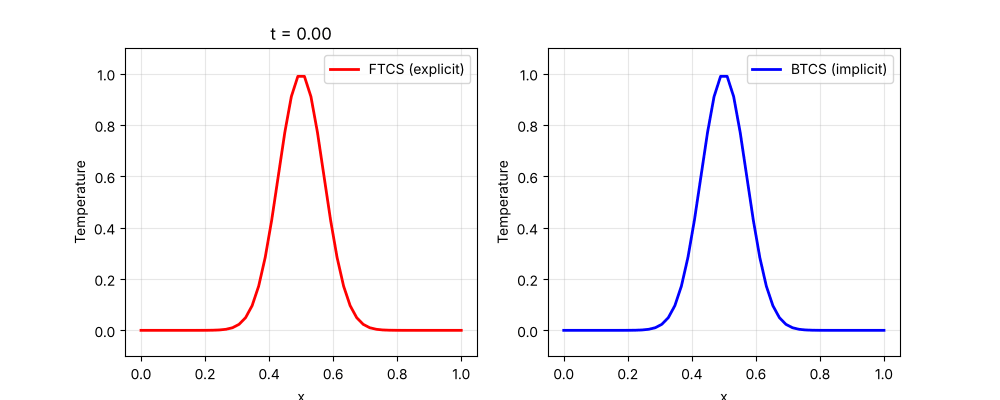
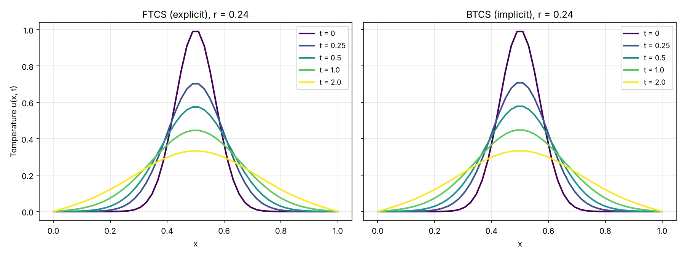
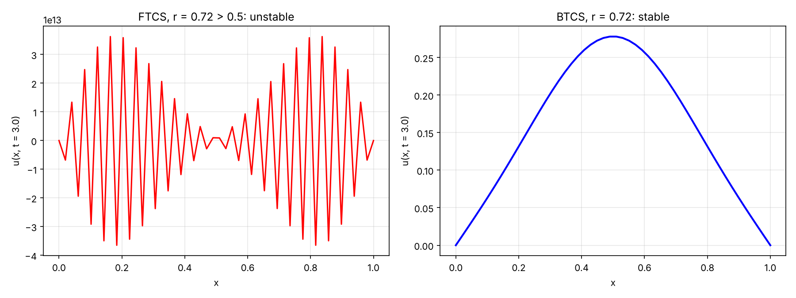

# 1D Heat Equation: Explicit (FTCS) vs Implicit (BTCS) Finite Differences

**Author:** Victoria Abosede Fagbemiro



## Problem
The one-dimensional heat equation on $0 \le x \le 1$:

```math
\frac{\partial u}{\partial t} = \alpha \frac{\partial^2 u}{\partial x^2}
```

with thermal diffusivity $\alpha = 0.01$, a Gaussian heat pulse $u(x, 0) = e^{-100 (x - 0.5)^2}$ as the initial condition, and the boundary values held fixed (Dirichlet conditions).

## Methods
The domain is split into $N_x = 50$ grid points with spacing $\Delta x$ and time step $\Delta t = 0.01$. Writing $r = \alpha \Delta t / \Delta x^2$:

**FTCS (forward time, centred space), explicit**

```math
u_i^{n+1} = u_i^n + r \left(u_{i+1}^n - 2u_i^n + u_{i-1}^n\right)
```

Cheap per step, but stable only when $r \le 1/2$.

**BTCS (backward time, centred space), implicit**

```math
(1 + 2r)\,u_i^{n+1} - r\,u_{i-1}^{n+1} - r\,u_{i+1}^{n+1} = u_i^n
```

A tridiagonal linear system is solved at every step (sparse solver), but the scheme is unconditionally stable.

## Results
With $r \approx 0.24$, both schemes are stable and show the heat pulse spreading out and flattening over time. They agree closely (maximum difference about $10^{-3}$ at $t = 2$).



**Stability check.** With a larger time step ($r \approx 0.72 > 1/2$), FTCS blows up while BTCS stays smooth, as theory predicts.



## Run it yourself
```bash
pip install -r requirements.txt
python heat_equation.py
```

## Repository files
```
heat_equation.py       clean script: both solvers, figures and animation
HeatTransferEQ.ipynb   original Google Colab notebook
heat_animation.gif     animation of both solutions over time
snapshots.png          solution at selected times
ftcs_unstable.png      stability check
requirements.txt
```
