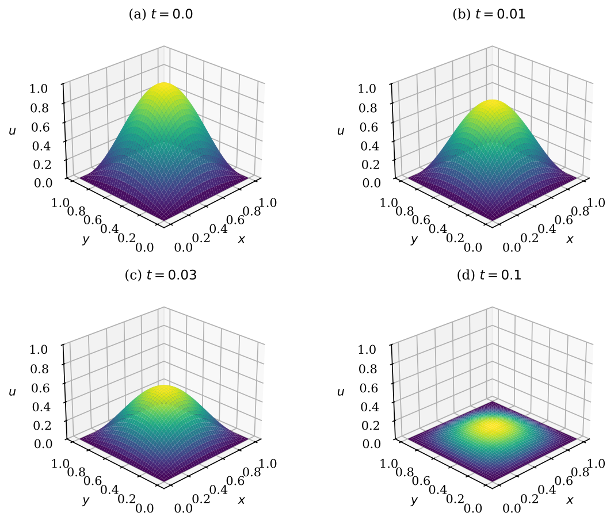
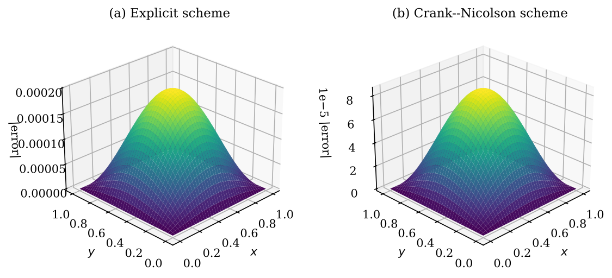
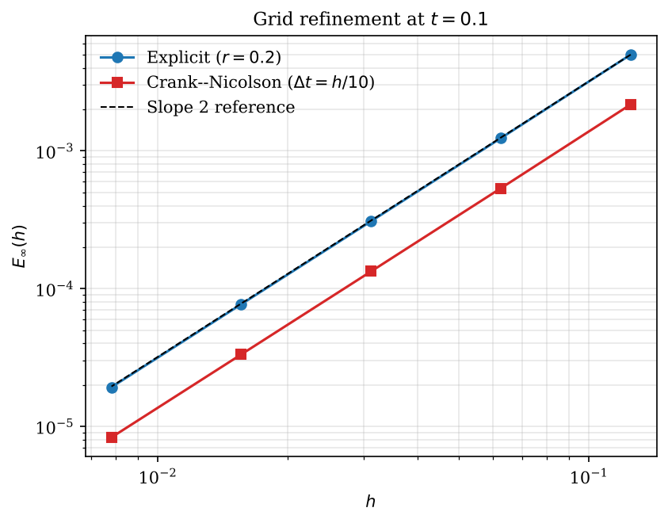
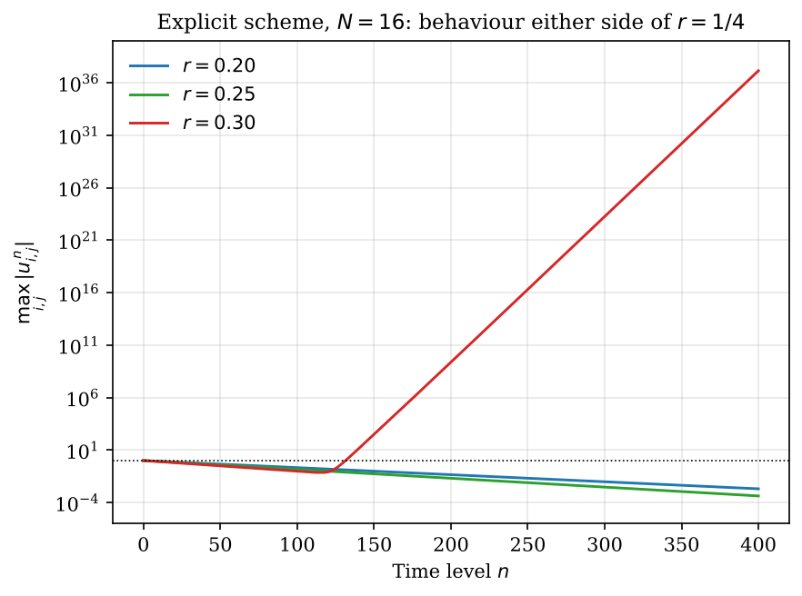
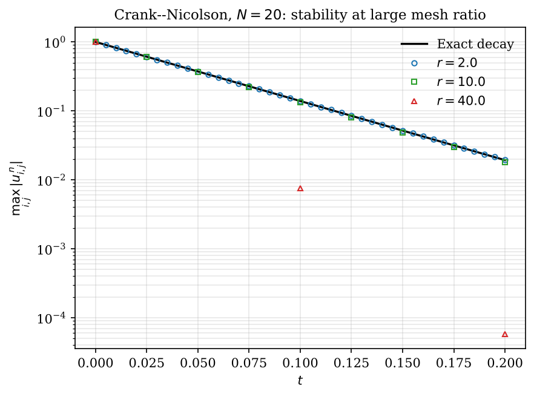

# The Heat Equation in 1D and 2D: Explicit vs Implicit Finite Differences

**Author:** Victoria Abosede Fagbemiro


This repository solves the heat equation numerically in one and two space dimensions and compares explicit and implicit finite difference schemes for accuracy and stability.

---

## Part 1: The 1D heat equation (FTCS vs BTCS)

The one-dimensional heat equation on $0 \le x \le 1$:

```math
\frac{\partial u}{\partial t} = \alpha \frac{\partial^2 u}{\partial x^2}
```

with thermal diffusivity $\alpha = 0.01$, a Gaussian heat pulse $u(x, 0) = e^{-100 (x - 0.5)^2}$ as the initial condition, and the boundary values held fixed. With $N_x = 50$ grid points, time step $\Delta t = 0.01$ and $r = \alpha \Delta t / \Delta x^2$:

**FTCS (forward time, centred space), explicit:** cheap per step, but stable only when $r \le 1/2$.

```math
u_i^{n+1} = u_i^n + r \left(u_{i+1}^n - 2u_i^n + u_{i-1}^n\right)
```

**BTCS (backward time, centred space), implicit:** a tridiagonal system is solved each step, but the scheme is unconditionally stable.

```math
(1 + 2r)\,u_i^{n+1} - r\,u_{i-1}^{n+1} - r\,u_{i+1}^{n+1} = u_i^n
```

With $r \approx 0.24$ both schemes are stable and agree closely (maximum difference about $10^{-3}$ at $t = 2$).


With a larger time step ($r \approx 0.72 > 1/2$), FTCS blows up while BTCS stays smooth.


---

## Part 2: The 2D heat equation (explicit vs Crank-Nicolson)

```math
\frac{\partial u}{\partial t} = \alpha \left(\frac{\partial^2 u}{\partial x^2} + \frac{\partial^2 u}{\partial y^2}\right), \qquad (x, y) \in [0, 1]^2
```

with $\alpha = 1$, $u = 0$ on the boundary and $u(x, y, 0) = \sin(\pi x)\sin(\pi y)$. This problem has the exact solution

```math
u(x, y, t) = e^{-2\pi^2 \alpha t} \sin(\pi x) \sin(\pi y),
```

which is used to measure the error of each scheme. The Laplacian is discretised with the five-point stencil on an $(N+1) \times (N+1)$ grid with spacing $h = 1/N$, built as a sparse Kronecker-product matrix, and $r = \alpha \Delta t / h^2$.

- **Explicit (Forward Euler, FTCS):** stable only when $r \le 1/4$.
- **Crank-Nicolson:** averages the explicit and implicit steps; second order in time and unconditionally stable. The sparse system matrix is LU-factorised once and reused at every time step.

### Solution evolution
Explicit scheme with $r = 0.2$ (top) and Crank-Nicolson with $\Delta t = h/10$, i.e. $r = 4$, sixteen times the explicit limit (bottom), on a $40 \times 40$ grid:




### Accuracy
At $t = 0.1$ on the $40 \times 40$ grid, the peak error is $1.97 \times 10^{-4}$ for the explicit scheme and $8.54 \times 10^{-5}$ for Crank-Nicolson, so Crank-Nicolson is about 2.3 times more accurate. The error vanishes on the boundary and peaks at the centre.



### Convergence study
Halving $h$ four times ($N = 8$ to $128$) gives an observed order of convergence of 2.000 for both schemes, matching the theoretical second-order accuracy:

| $N$ | Max error, explicit | Order | Max error, Crank-Nicolson | Order |
|---|---|---|---|---|
| 8 | 4.995e-03 | | 2.172e-03 | |
| 16 | 1.237e-03 | 2.0135 | 5.356e-04 | 2.0198 |
| 32 | 3.086e-04 | 2.0034 | 1.334e-04 | 2.0050 |
| 64 | 7.710e-05 | 2.0008 | 3.333e-05 | 2.0012 |
| 128 | 1.927e-05 | 2.0002 | 8.331e-06 | 2.0003 |



### Stability
Running the explicit scheme at $r = 0.20$, $0.25$ and $0.30$ on a $16 \times 16$ grid: the first two decay, while $r = 0.30$ decays for about 120 steps and then blows up, because the unstable high-frequency mode has to grow from round-off error. On this finite grid the exact discrete threshold is $r^* = 0.2524$, slightly above the textbook value of $1/4$, and the predicted growth factor at $r = 0.30$ is 1.377 per step, which matches the measured growth.



Crank-Nicolson stays bounded and tracks the exact decay even at $r = 40$, which is 160 times the explicit stability limit.



---

## Run it yourself
```bash
pip install -r requirements.txt
python heat_equation.py   # 1D
python heat_2d.py         # 2D (the convergence study takes a minute or two)
```

## Repository files
```
heat_equation.py        1D solvers (FTCS, BTCS), figures and animation
heat_2d.py              2D solvers (explicit, Crank-Nicolson), error, convergence and stability analysis
HeatTransferEQ.ipynb    original 1D Google Colab notebook
heat_animation.gif      animation of the 1D solutions
snapshots.png, ftcs_unstable.png            1D figures
heat2d_fig*.png         2D figures
requirements.txt
```
